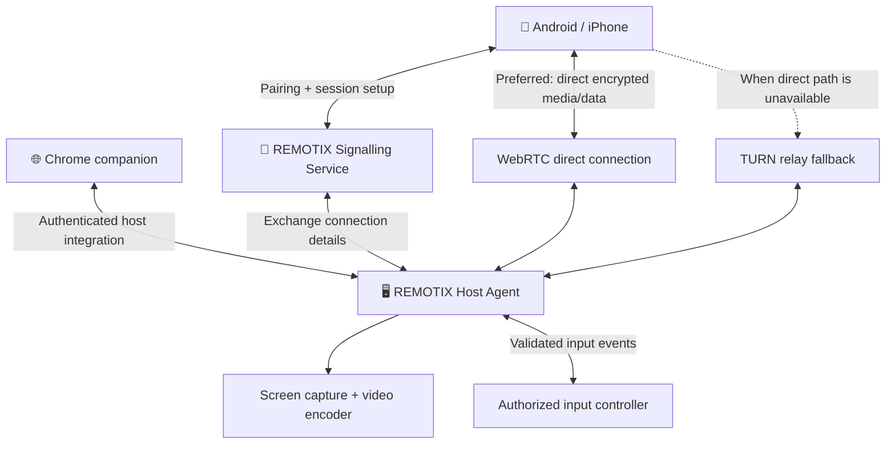

<!--
  REMOTIX — README
  Keep this document honest: planned capabilities are not presented as shipped features.
-->

<div align="center">

# ⚡ REMOTIX

### Your PC. Anywhere. Anytime.

**A high-performance, cross-platform remote desktop platform — built for responsive control, secure connections, and freedom across devices.**

<br />

[](https://www.rust-lang.org/)
[](https://flutter.dev/)
[](https://webrtc.org/)
[](#-platforms)
[](LICENSE)

<br />

[**Explore the project**](#-project-overview) · [**Architecture**](#-how-it-works) · [**Roadmap**](#-roadmap) · [**Contributing**](#-contributing)

<br />

> **Project status:** Early development · Core workspace and initial signalling health endpoint are running. Remote-control features are not yet implemented.

</div>

---

## ✨ Project overview

REMOTIX is being built to let you securely access and control your own computer from a registered phone or another authorized device — whether you're on the same Wi-Fi network or connecting across the internet.

The goal is simple: make remote access feel immediate and dependable, without sacrificing security.

### What we're building

| Capability | Direction |
|---|---|
| 🖥️ Remote desktop | View and interact with an authorized Windows or Linux computer |
| 📱 Mobile control | Use Android and iPhone as remote-control clients |
| 🎥 Low-latency streaming | Real-time screen delivery using WebRTC and hardware acceleration where available |
| 🖱️ Full input control | Mouse, keyboard, touch, scrolling and common shortcuts |
| 🌍 Anywhere connectivity | Direct peer-to-peer connections where possible, with relay fallback |
| 🔐 Trusted devices | Explicit device pairing, authenticated sessions and device revocation |
| 🧩 Browser companion | Chrome extension integrated with the host through Native Messaging |

*These are project goals, not a claim that these features are already available.*

## 🧭 Platforms

| Platform | Planned role | Technology |
|---|---|---|
| Windows 11 | Remote host / controlled PC | Rust native host |
| Linux | Remote host / controlled PC | Rust native host |
| Android | Remote-control client | Flutter |
| iOS | Remote-control client | Flutter |
| Google Chrome | Companion extension | TypeScript, Manifest V3 |
| Desktop UI | Host management interface | Tauri |

## ⚙️ How it works

REMOTIX is designed around a small signalling service and a direct real-time media/control path.



### Connection strategy

1. **Pair** — explicitly register and authorize the devices.
2. **Authenticate** — establish a session using short-lived credentials.
3. **Connect** — negotiate a WebRTC connection through the signalling service.
4. **Stream and control** — send screen media and authorized input over the session.
5. **Recover** — use a TURN relay when a direct peer-to-peer route cannot be established.

A truly zero-latency connection is not physically possible. REMOTIX will focus on reducing avoidable delay through efficient capture, encoding, transport, decoding and input handling.

## 🏗️ Technology

| Layer | Technology | Purpose |
|---|---|---|
| Host agent | **Rust** | Native capture, input and session components |
| Mobile client | **Flutter** | Android and iOS application |
| Desktop interface | **Tauri** | Lightweight host-management UI |
| Browser extension | **TypeScript · Manifest V3** | Chrome companion and Native Messaging |
| Signalling service | **Rust · Axum · WebSocket** | Pairing and connection negotiation |
| API service | **Python · FastAPI** | Application and account APIs |
| Real-time transport | **WebRTC** | Interactive media and data transport |
| NAT traversal | **STUN / TURN · coturn** | Connectivity across networks |
| Data layer | **PostgreSQL · Redis** | Persistent records and ephemeral session state |

## 📁 Repository layout

```text
REMOTIX/
├── apps/
│   ├── mobile/                  # Flutter: Android + iOS
│   ├── chrome-extension/        # TypeScript browser companion
│   └── desktop-ui/              # Tauri desktop interface
├── agents/
│   └── host/                    # Rust remote host agent
│       └── src/
│           ├── capture/
│           ├── input/
│           ├── streaming/
│           ├── pairing/
│           └── platform/
│               ├── windows/
│               └── linux/
├── services/
│   ├── signaling/               # Rust signalling service
│   ├── api/                     # FastAPI application
│   └── relay/                   # Relay service configuration
├── packages/
│   └── protocol/                # Shared protocol definitions
├── infrastructure/
│   ├── docker/
│   └── coturn/
└── docs/                        # Architecture and engineering docs
```

## 🚧 Development status

REMOTIX is in its foundation stage. The repository and Rust workspace are initialized, and the initial signalling HTTP health endpoint has been compiled and tested locally.

| Area | Status |
|---|---|
| Repository and workspace setup | ✅ Complete |
| Rust host and signalling crates | ✅ Initial scaffolds compile |
| Signalling health endpoint | ✅ Local smoke test passed |
| Authenticated device pairing | 🔜 Planned |
| WebSocket session negotiation | 🔜 Planned |
| WebRTC media and data transport | 🔜 Planned |
| Windows screen capture and input | 🔜 Planned |
| Linux capture and input | 🔜 Planned |
| Flutter mobile clients | 🔜 Planned |
| Chrome extension and Native Messaging | 🔜 Planned |
| TURN deployment and production hardening | 🔜 Planned |

**No production-ready remote session is available yet.** The roadmap will be updated as features are implemented and tested.

## 🔒 Security principles

Remote access is powerful. Security is a core requirement, not an optional layer.

- **Explicit pairing:** only devices deliberately registered by the account owner should be able to connect.
- **Authenticated sessions:** validate every session and authorize every control action.
- **Encrypted transport:** protect signalling and real-time session traffic in transit.
- **Least privilege:** request only the operating-system permissions needed for the selected feature.
- **Visible access:** show when a remote session is active and provide an immediate disconnect control.
- **Revocation:** allow a trusted device to be removed and prevent it from reconnecting.
- **No silent access:** the host must not hide remote activity or bypass operating-system consent and security controls.

Security mechanisms will be documented alongside their implementation; this section describes design principles, not a certification or completed security audit.

## 🗺️ Roadmap

- [x] Set up the repository and Rust workspace
- [x] Compile the initial host and signalling crates
- [x] Run and verify the signalling health endpoint
- [ ] Define versioned pairing and session protocol
- [ ] Implement authenticated WebSocket signalling
- [ ] Build device registration and revocation
- [ ] Establish WebRTC connectivity and TURN fallback
- [ ] Implement host capture and input backends
- [ ] Build the Flutter remote-control client
- [ ] Add Chrome Native Messaging integration
- [ ] Add observability, automated tests and deployment
- [ ] Conduct security and performance testing

## 🧑‍💻 Development

### Prerequisites

- Rust stable toolchain and Cargo
- Git
- Ubuntu / Linux development environment (WSL2 is suitable for the current Rust workspace)
- Additional platform SDKs will be needed as the mobile, browser and native host components are implemented

### Check the Rust workspace

Clone the repository:

```bash
git clone https://github.com/MrAryanKode/REMOTIX.git
cd REMOTIX
```

Check all Rust workspace members:

```bash
cargo check --workspace
```

Run the current signalling service:

```bash
cargo run -p remotix-signaling
```

In another terminal, verify its local health endpoint:

```bash
curl http://127.0.0.1:8787/health
```

Expected response:

```text
REMOTIX signalling online
```

The current endpoint is a local development health check; it is not an internet-facing production service.

## 🤝 Contributing

REMOTIX is at an early stage, and thoughtful contributions are welcome.

1. Open an issue to discuss a bug, feature or architectural change.
2. Keep pull requests focused and explain the reasoning behind the change.
3. Include tests or reproducible verification where practical.
4. Never commit credentials, private keys, tokens or personal session data.
5. Do not describe unfinished functionality as production-ready.

For substantial changes, please discuss the approach in an issue before opening a pull request.

## 📌 Project

**Repository:** [github.com/MrAryanKode/REMOTIX](https://github.com/MrAryanKode/REMOTIX)

**Maintainer:** [@MrAryanKode](https://github.com/MrAryanKode)

---

<div align="center">

### Built with ambition. Engineered for control.

**REMOTIX** · Your PC. Anywhere. Anytime.

<sub>Early-stage open-source project. Contributions, feedback and thoughtful engineering are welcome.</sub>

</div>
